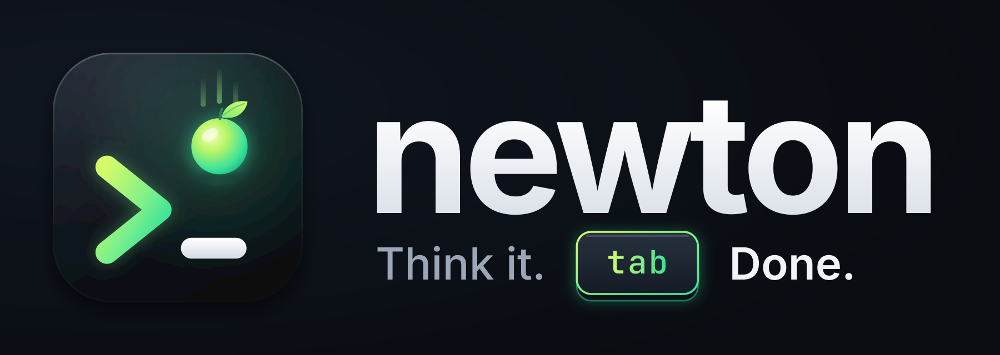

<p align="center"></p>

<p align="center"><b>Think it. Tab it. Done.</b><br>
Plain English → the exact shell command, written straight into your prompt. For bigger jobs, a step-by-step plan you can follow, fix and finish without leaving the terminal.</p>

---

```text
~/projects/api $ kill whatever is using port 3000⇥
~/projects/api $ lsof -ti tcp:3000 | xargs kill
  ❯ Finds the process listening on port 3000 and stops it.   ·  ⇥ 2 more   ·  ⇧⇥ undo
```

You know what you want to do. You just don't remember whether it's `tar -xzvf` or `-zxvf`, which `find` flag means "bigger than", or how `lsof` takes a port. So you open a browser, search, skim a forum thread, copy, paste, edit. **Newton cuts that loop to a single key.**

## Why Newton

|  |  |
|---|---|
| **Lives in your prompt** | No new window, no chat, no copy-paste. Type a sentence, press Tab, and the command replaces it in place. |
| **Never runs anything** | Newton only *writes* the command. You read it, tweak it, and press Enter yourself. |
| **Tab still works normally** | Newton tells sentences apart from commands. `git ch⇥` still completes `checkout`, and only plain English goes to Newton. |
| **Knows your machine** | Uses BSD flags on macOS and GNU flags on Linux, your package manager, the tools you actually have installed, and the files in the current folder. |
| **Safety net built in** | A local rule engine flags `rm -rf`, `sudo`, force-pushes, `curl \| sh`, disk writes and more, whatever the AI says. |
| **Alternatives on demand** | Press Tab again to cycle through other ways to do it. Shift+Tab puts your original words back. |
| **Fast & private** | Repeat requests come back instantly from a local cache. Bring your own key, or run fully offline with Ollama. No telemetry. |

## Install

Newton is **one file** that needs only Python 3.9+ (already on macOS, Linux and Chromebooks' Linux terminal). No pip, no virtual environment, no admin rights.

```sh
unzip newton.zip && cd newton
sh install.sh
```

The installer puts `newton` in `~/.local/bin`, makes sure that folder is on your `PATH` in your shell config, then walks you through choosing an AI and turning on Tab. Open a new terminal when it finishes.

| Where | Notes |
|---|---|
| **macOS** | Works with the built-in Python 3 (`xcode-select --install` if it asks). zsh is the default shell. |
| **Linux** | Any distro with `python3`. If it's missing, the installer tells you the exact command for your distro. |
| **Chromebook** | Turn on *Linux* in Settings and open the **Terminal** app. Drag `newton.zip` from *My files › Downloads* into *Linux files* (that's `~` in the terminal), then run the steps above. If `unzip` or `python3` is missing: `sudo apt update && sudo apt install -y unzip python3` |
| **Windows** | Use WSL (Ubuntu), then follow the Linux steps. |

It supports **zsh, bash 4+ and fish**. The installer only edits config files for shells you already use, and only inside a clearly marked block it can remove again.

### Update

Download the newest `newton.zip`, then:

```sh
newton update                      # finds the newest newton*.zip in ~/Downloads
newton update ~/Downloads/newton.zip
newton update https://…/newton.zip # https only
```

It shows the version change, asks first, builds and tests the new copy, and only then replaces the old one. A broken download can never replace a working install. Your settings, key and saved plans are untouched.

### Uninstall

```sh
newton uninstall            # removes the program and Newton's lines in your shell config
newton uninstall --purge    # also deletes your settings, API key, history and saved plans
```

<details><summary>Other ways to install</summary>

```sh
pipx install .                  # or: python3 -m pip install --user --break-system-packages .
sh install.sh --no-setup        # skip the guided setup
sh install.sh --no-path         # don't touch shell config files
sh install.sh --bin-dir ~/bin   # install somewhere else
NEWTON_URL=https://…/newton.zip sh install.sh   # download and install in one step
```

To wire it up by hand instead of using `newton setup`:

```sh
echo 'eval "$(newton init zsh)"'  >> ~/.zshrc                   # zsh
echo 'eval "$(newton init bash)"' >> ~/.bashrc                  # bash 4+
echo 'newton init fish | source'  >> ~/.config/fish/config.fish # fish
```
</details>

## Plan mode: big jobs, one terminal tab

For anything bigger than one command, give Newton a goal. It drafts a **checklist**, then walks you through it. You stay in control of every step.

```text
$ newton plan set up a python project with pytest and a git repo

  ◆ Python project   step 2 of 5 · 40%
  ━━━━━━━━━━━━━━━━━━━━━━━━━────────────────────────
  ✓  1  Create the project folder
  ▸  2  Make a virtual environment
  ○  3  Install pytest
  ○  4  Add a first test
  ○  5  Initialise git

  Step 2 of 5  Make a virtual environment
  ❯ python3 -m venv .venv
  ⏎ run   e edit   s skip   ? explain   a ask   r revise   q pause
```

- **A label and a live checklist** show the goal, the current step and the percentage, so you always know where you are.
- **Press one key per step.** <kbd>⏎</kbd> runs it, <kbd>e</kbd> edits it, <kbd>s</kbd> skips it, <kbd>?</kbd> explains it, <kbd>a</kbd> asks a question about it, <kbd>r</kbd> revises the plan, <kbd>q</kbd> pauses.
- **State carries over.** `cd` and `export` in one step apply to the next, like one long shell session.
- **Plans ask for what they need.** Names, ports and paths become inputs up front (`$SITE_NAME`), not guesses buried in commands.
- **Failures get fixed.** If a step fails, Newton reads the error, proposes a fix and retries. You can run it, edit it, retry as-is, skip or ask.
- **Dangerous steps need a deliberate <kbd>y</kbd>.** Even `--yes` only auto-runs steps that are safe. Destructive steps always wait for you.
- **Manual steps are tracked too**, like "create a key in the dashboard", so the checklist matches reality.
- **Pause and pick up later.** Press <kbd>q</kbd> or Ctrl+C and the plan is saved. `newton resume` continues from the same step, even in a new terminal. If the plan's folder was moved or deleted, Newton stops and asks instead of running somewhere else.
- **Preflight check.** Before anything runs, the plan lists the programs it needs (`git`, `node`, `docker`) with a ✓ or ✗ for what's installed on your machine.
- **Undo.** Steps that create things come with an undo. `newton plans undo` reverses them newest first, in the folder each one ran in, and asks before every one. Destructive undos need a deliberate <kbd>y</kbd> too.
- **Take it with you.** `newton plans export -o setup.sh` turns a finished plan into a script that asks before dangerous steps and reads its inputs from variables. `--md` gives a checklist for a README or a ticket.
- **Always visible.** Progress is shown in your terminal tab title, each step's duration is recorded, and long steps ring the bell when they finish so you can look away.
- **Built for small models.** Local models often return slightly broken JSON. Newton repairs the common slips and, if a reply is still unusable, asks once more, strictly, before giving up.

```sh
newton plan "deploy this app to a VPS"   # draft, review, run
newton plan --dry-run "…"                # just show the plan
newton plan -y "…"                       # auto-run safe steps (danger steps still ask)
newton status                            # the checklist for your active plan (--md for a markdown version)
newton plans [list|show|rm] [id]         # saved plans
newton resume                            # continue where you stopped
newton plan                              # no goal: offers to resume, or asks what you want to get done
newton plans undo [id]                   # roll back finished steps, newest first
newton plans export [id] [-o FILE] [--md]  # a runnable script (or markdown checklist) from a plan
newton prompt                            # a short badge for your prompt: ◆ Python project · 2/5
```

Put `$(newton prompt)` in your prompt if you want the active plan always visible.

## Never leave the terminal

| Command | What it does |
|---|---|
| `newton ask <question>` | Streams an answer in your terminal. Pipe anything in (`make 2>&1 \| newton ask why did this fail`) or attach files with `-f app.py`. |
| `newton chat` | A conversation with your shell attached. `!cmd` runs a command and shows Newton the output, `/run` executes the last code block. |
| `newton fix` | Looks at your **last command**, re-runs it to see the real error, explains what went wrong and offers a fix. Destructive commands are never re-run. |
| `newton commit` | Reads your staged diff and writes a clear commit message. You approve it before anything is committed. |

`newton fix` needs the shell integration, which records your last command and exit status in a private file. Command text is never put in your environment.

For the best plans, use a stronger model for the heavy work: `newton config smart_model claude-sonnet-5-5`. Plain Tab suggestions keep using the fast model.

## Keys

| Key | What it does |
|---|---|
| <kbd>Tab</kbd> | Plain English → command. On a normal command, ordinary completion. |
| <kbd>Tab</kbd> again | Cycle through alternative commands |
| <kbd>Shift</kbd>+<kbd>Tab</kbd> | Undo: put your original words back |
| <kbd>Alt</kbd>+<kbd>N</kbd> | Force Newton on the current line, whatever it looks like |
| `# …` | Lines starting with `#` always go to Newton |

**How Newton decides what's a sentence:** a line goes to Newton if it starts with `#`, or if it has at least 3 words, no shell syntax (`| > & ; $ = "` …) and no flags, *and* either its first word isn't a real command or it reads like English (`kill whatever is using port 3000`). Anything else gets your normal Tab completion. If you want Newton to fire only on `#` lines, run `newton config trigger prefix`.

## Command line

```sh
newton find every jpg modified this week            # print a suggestion (shorthand for `newton suggest`)
newton suggest -c "compress the logs folder"         # …and copy it to the clipboard
newton suggest --json "list docker containers"       # full JSON (command, alternatives, explanation, danger)
newton explain 'tar -xzvf release.tgz -C /opt'       # flag-by-flag breakdown
newton history                                       # what you've asked recently
newton doctor                                        # check key, connection and shell integration
newton config                                        # show settings · newton config <key> <value> to change
```

## Providers

| Provider | Setup | Default model |
|---|---|---|
| **Claude** (recommended) | API key from console.anthropic.com, or `ANTHROPIC_API_KEY` | `claude-haiku-5-5` |
| OpenAI-compatible | Any `/chat/completions` endpoint plus key (`OPENAI_API_KEY`) | `gpt-4o-mini` |
| Ollama | Local and offline. `ollama pull llama3.1` | `llama3.1` |

Change model: `newton config model claude-sonnet-5-5`. Every setting can also be overridden per-shell with `NEWTON_PROVIDER`, `NEWTON_MODEL`, `NEWTON_API_KEY` and `NEWTON_BASE_URL`.

## Settings

| Key | Default | Meaning |
|---|---|---|
| `provider` | `anthropic` | `anthropic`, `openai` or `ollama` |
| `model` | provider default | Model name |
| `alternatives` | `2` | Extra commands to cycle with Tab (0–5) |
| `share_file_names` | `true` | Send top-level file names in the current folder for better answers |
| `cache` | `true` | Answer repeat requests instantly from the local cache |
| `trigger` | `smart` | `smart` or `prefix` (only `#` lines) |
| `timeout` | `20` | Seconds to wait for the AI on Tab suggestions |
| `smart_model` | *(same as model)* | Stronger model for plan, ask, chat, fix and commit |
| `plan_timeout` | `90` | Seconds to wait while drafting a plan |
| `plan_max_steps` | `15` | Upper limit on steps in a plan |
| `share_output` | `true` | Send the (redacted) output of a failed step to the AI so it can diagnose it |

Config lives in `~/.config/newton/config.json` (permissions `600`). Cache and history are in `~/.cache/newton/`, saved plans in `~/.local/share/newton/plans/`. All three folders are owner-only (`700`).

## Privacy

Each request sends **only** your description plus a short environment summary: OS, shell, current folder path, project type, installed tool names, and top-level file names (which you can turn off). Tab suggestions never send file *contents*, environment variables, shell history or your previous commands.

The bigger features send more, and only when you use them:

- **Plan mode** sends your goal, your answers to its questions and, if a step fails, the last lines of that step's output so Newton can diagnose it. Turn that off with `newton config share_output false`.
- **`ask` and `chat`** send what you type or pipe in, and files you attach with `-f`. Files that look like secrets (`.env`, keys, credentials) are refused.
- **`fix`** sends your last command and its output. **`commit`** sends your staged diff.

Everything sent passes through a redactor first: API keys, tokens, passwords and private keys are replaced with placeholders. With Ollama nothing leaves your machine.

## How it works

```text
 your prompt ──Tab──▶ shell widget ──is it English?──no──▶ normal completion
                           │ yes
                           ▼
                 newton suggest --porcelain
                   ├─ context: OS · shell · tools · project · files
                   ├─ cache hit? → instant
                   ├─ AI provider (Claude · OpenAI-compatible · Ollama)
                   └─ local safety rules
                           │
                           ▼
             command replaces your words in the prompt  (nothing executed)
```

```text
newton/
├── cli.py         commands: suggest · plan · ask · chat · fix · commit · explain · setup · …
├── engine.py      Tab suggestions: prompt, cache, history
├── llm.py         providers (Claude · OpenAI-compatible · Ollama), streaming
├── brain.py       plan drafting, diagnosis and revision
├── planrun.py     the interactive plan runner and checklist UI
├── planstore.py   saved plans, status, resume
├── runner.py      runs steps in one persistent shell session
├── chat.py        ask and chat
├── fixcmd.py      newton fix
├── gitcmds.py     newton commit
├── term.py        keypress input and terminal drawing
├── installer.py   single-file install, update, uninstall (standard library only)
├── context.py     OS / shell / tools / project detection
├── safety.py      local risk rules (always on)
├── config.py      settings + env overrides
├── ui.py          terminal styling (honours NO_COLOR)
└── shells/        zsh · bash · fish Tab widgets
```

## Development

```sh
python3 -W ignore -m unittest discover -s tests -v
```

The suite runs against a local mock of the API (no key or network needed) and includes **live end-to-end tests** that open real zsh, bash and fish sessions in a pseudo-terminal. They type a sentence, press Tab, cycle alternatives, undo, and check that normal completion is untouched. A second suite (`tests/test_agent.py`) covers plan mode end to end: single-keypress runs in a real pty, failure → fix → retry, pause and resume, danger gating, and the last-command hooks in all three shells.

## Troubleshooting

- **Tab does normal completion on my sentence.** Start the line with `#`, or press <kbd>Alt</kbd>+<kbd>N</kbd>.
- **Tab stopped completing with oh-my-zsh or fzf-tab.** Load Newton *after* other plugins (put the `eval` line last) so it can hand Tab back to them.
- **macOS bash.** The built-in bash 3.2 is too old. `brew install bash`, or use zsh (the macOS default).
- **`newton: command not found` after installing.** Open a new terminal. If it persists, run `~/.local/bin/newton doctor`; it checks your PATH and tells you what to fix.
- **Something else is shadowing Newton.** `newton doctor` warns when your shell finds a different `newton` first (for example an old pip install). Remove the other copy.
- **Anything else:** run `newton doctor`.

## License

MIT
